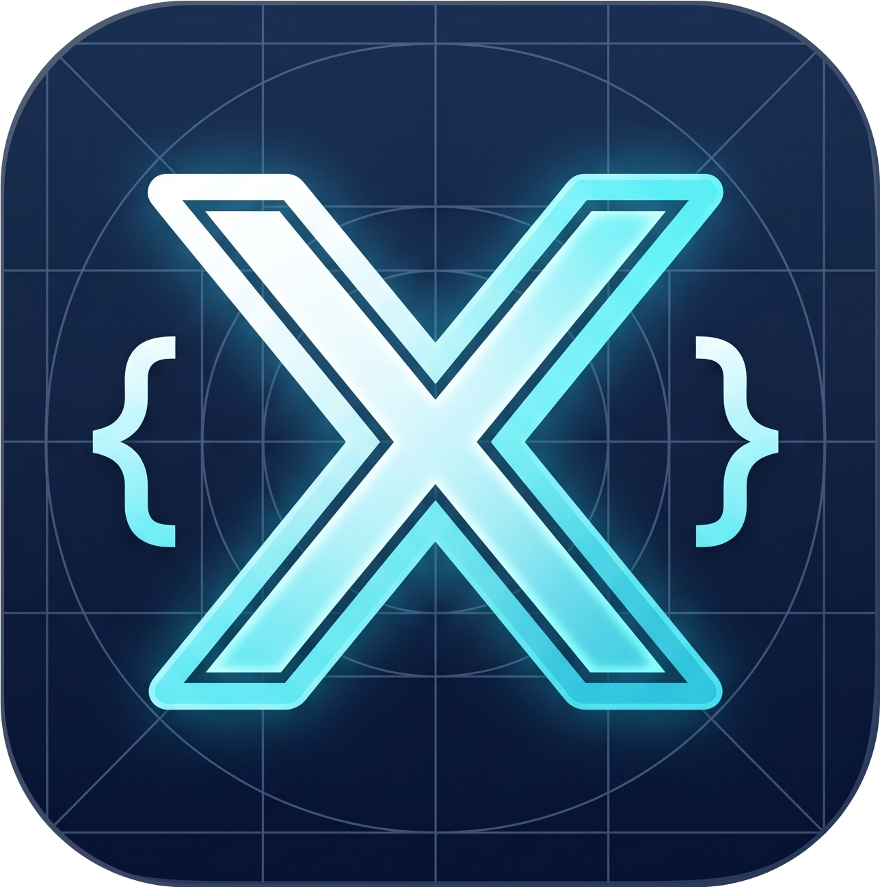
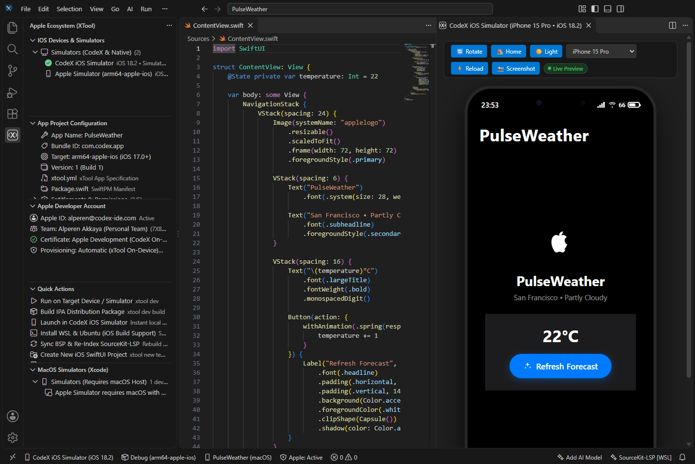
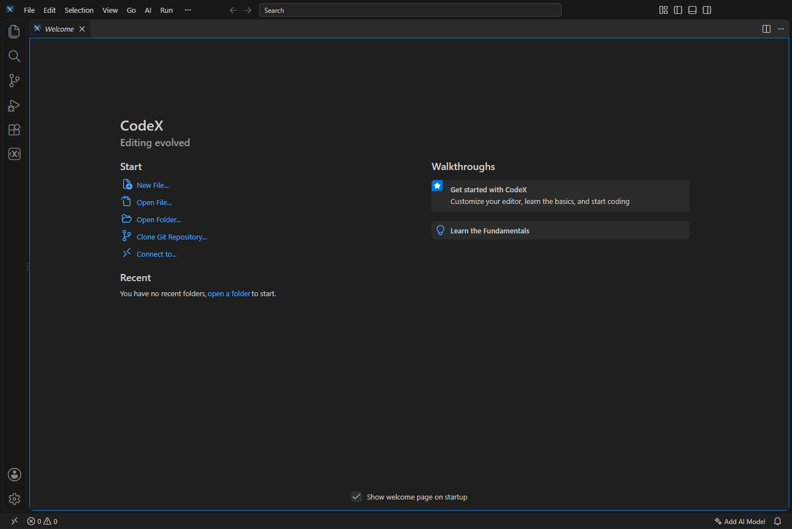
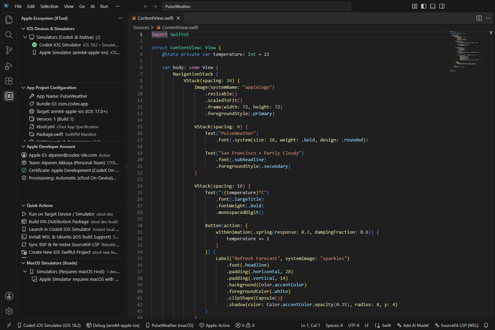
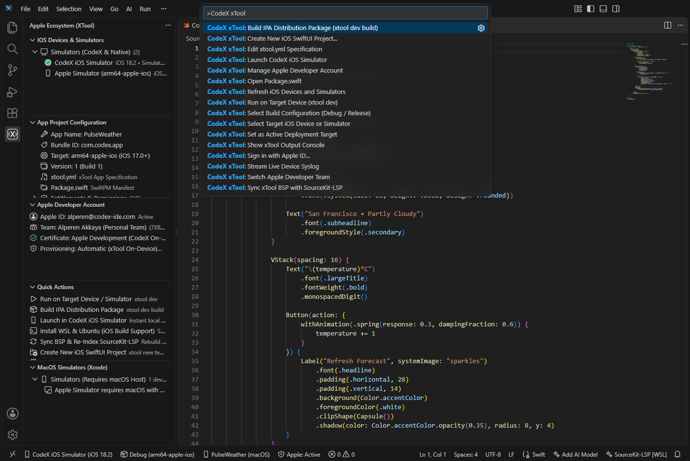
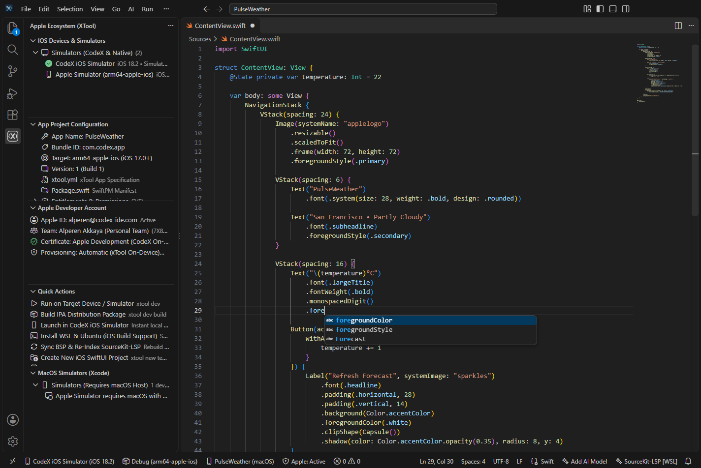
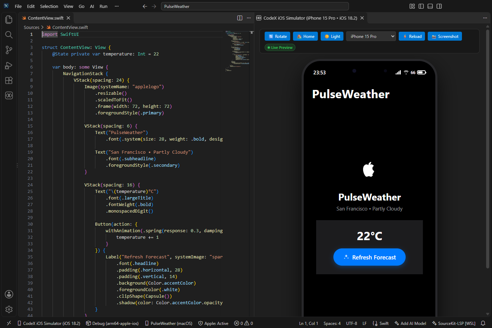
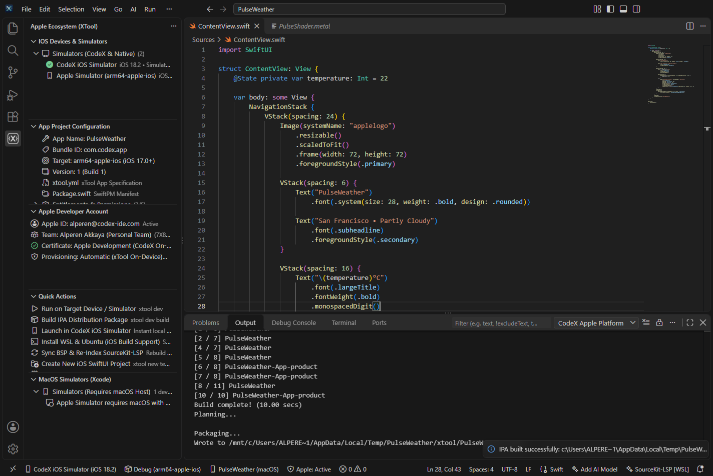
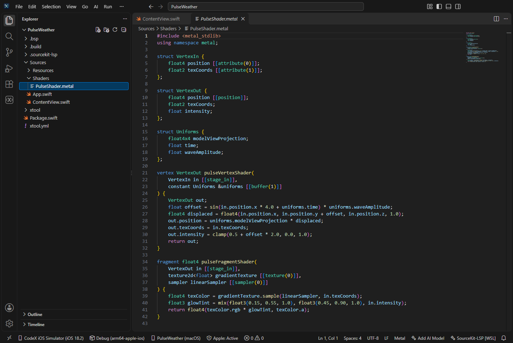

<p align="center">
  
</p>

<h1 align="center">CodeX</h1>

<p align="center">
  <strong>The Native Apple Development IDE for Windows</strong><br>
  Build, test, and ship real iOS apps with Swift and SwiftUI — no Mac required.
</p>

<p align="center">
  
  
  
  
  
  
</p>

---

## Overview

CodeX is a professional development environment that brings native Apple ecosystem development to Windows. It eliminates the traditional requirement of owning Mac hardware to build iOS and iPadOS applications.

Unlike cross-platform wrappers or transpilers, CodeX uses the **actual Apple Swift compiler** and **genuine Darwin iOS SDK** to produce real `.ipa` packages identical to those built on macOS. The entire toolchain — from code editing and live preview to compilation, signing, and packaging — runs natively on Windows through an optimized WSL bridge.

<p align="center">
  
</p>

---

## Key Capabilities

| Capability | Description |
|:---|:---|
| **Swift & SwiftUI Editor** | Full language server via SourceKit-LSP — autocomplete, hover docs, Go to Definition, diagnostics |
| **C / C++ / Objective-C / Metal** | Syntax highlighting, snippets, and Metal Shading Language grammar |
| **ARM64 Assembly** | Built-in ARM64 assembly syntax support |
| **Built-in iOS Simulator** | SwiftUI Parser, Renderer, and State Engine with live preview in a WebView panel |
| **SF Symbols Provider** | Search and insert Apple SF Symbols icons directly in the editor |
| **iOS Theme Engine** | iOS typography, color palette, and design token integration |
| **Live Preview** | Instantly reflect SwiftUI changes in the simulator without saving |
| **1-Click IPA Build** | Produce a real iOS IPA package via xTool with a single button click |
| **LLDB DAP Debugger** | Step-through debugging for native iOS apps — breakpoints, watch, call stack |
| **Syslog Streaming** | Live console log feed from physical devices |
| **BSP Integration** | Build Server Protocol bridge between IDE and xTool compiler |
| **Automatic WSL Setup** | One-click Windows Subsystem for Linux and Ubuntu environment provisioning |
| **Pre-bundled SDK** | Built-in Darwin iOS SDK (epoch=4) — no Xcode download required |
| **On-Device Signing** | Free (7-day) or paid Apple Developer account with automatic provisioning |

---

## Screenshots

<p align="center">
  <br>
  <em>Welcome screen with quick-start actions, recent workspaces, and interactive walkthroughs</em>
</p>

<p align="center">
  <br>
  <em>Apple Ecosystem sidebar — simulators & devices, app project configuration, developer account, and quick actions</em>
</p>

<p align="center">
  <br>
  <em>Command Palette & Quick Actions — one-click IPA builds, simulator launch, BSP sync, and project scaffolding</em>
</p>

<p align="center">
  <br>
  <em>Swift & SwiftUI editor with active SourceKit-LSP [WSL] integration, autocomplete, and syntax highlighting</em>
</p>

---

## Architecture

CodeX bridges the gap between Windows and Apple's development ecosystem through a layered architecture:

```
┌─────────────────────────────────────────────────────────┐
│                      CodeX IDE                          │
│                                                         │
│  ┌──────────┐  ┌──────────┐  ┌───────────────────────┐ │
│  │  Editor   │  │  Debug   │  │   iOS Simulator       │ │
│  │  (LSP)    │  │  (DAP)   │  │   Engine (WebView)    │ │
│  └─────┬─────┘  └─────┬────┘  └──────────┬────────────┘ │
│        │              │                   │              │
│  ┌─────┴──────────────┴───────────────────┴────────────┐ │
│  │        swift-language-features Extension            │ │
│  │   BSP · Runner · Apple · Simulator · Device · UI   │ │
│  └──────────────────────┬──────────────────────────────┘ │
│                         │                                │
│  ┌──────────────────────┴──────────────────────────────┐ │
│  │          xtool-bridge.mjs (Node.js)                 │ │
│  │  Win ↔ WSL path translation · Python SDK extractor  │ │
│  └──────────────────────┬──────────────────────────────┘ │
└─────────────────────────┼────────────────────────────────┘
                          │
┌─────────────────────────┼────────────────────────────────┐
│              WSL (Ubuntu Linux)                          │
│                         │                                │
│  ┌──────────────────────┴──────────────────────────────┐ │
│  │       xTool CLI (ELF binary)                        │ │
│  │  Swift Compiler · Linker (ld64.lld) · Packager      │ │
│  └──────────────────────┬──────────────────────────────┘ │
│                         │                                │
│  ┌──────────────────────┴──────────────────────────────┐ │
│  │       Darwin iOS SDK (darwin.artifactbundle)         │ │
│  │  epoch=4 · iOS 17.0+ / SDK 27.2 · arm64-apple-ios  │ │
│  └─────────────────────────────────────────────────────┘ │
└──────────────────────────────────────────────────────────┘
```

**Data flow:** Source code is edited in the CodeX editor with full LSP support. When a build is triggered, `xtool-bridge.mjs` translates Windows paths to WSL paths and invokes the xTool CLI inside Ubuntu. xTool calls the Swift compiler with the pre-bundled Darwin SDK headers and libraries, links the binary with `ld64.lld`, and packages the result into a signed `.ipa` archive. The bridge handles UTF-16/UTF-8 encoding differences, closes stdin to prevent interactive prompts, and uses a Python-based extractor to work around WSL 1 kernel limitations.

---

## Quick Start

### Portable Edition (No Installation)

1. Extract `CodeX-win32-x64.zip` to any directory.
2. Run `CodeX.exe`.
3. From the sidebar, select **Quick Actions > Create New iOS SwiftUI Project**.
4. Preview your app immediately with **Launch in CodeX iOS Simulator**, or run **Install WSL & Ubuntu** from Quick Actions before triggering **Build IPA Distribution Package**.

### Installer Edition

1. Run `CodeXSetup-x64-user.exe` (or `-system.exe` for all users).
2. During setup, keep the **Apple iOS Development Support (WSL2 & Ubuntu)** setup task checked.
3. Complete the wizard — WSL, Ubuntu, and the Darwin SDK are configured automatically.
4. If a reboot is required for WSL, the setup resumes automatically after restart.

> **Note on Bundled SDKs & Evaluation:** CodeX preview builds (`v1.148.0`) operate under [DISCLAIMER.md](DISCLAIMER.md). Third-party runtime modules, Apple SDK tooling (`darwin.xtoolsdk`), and Copilot integrations carry separate third-party licensing terms and commercial redistribution restrictions documented in [THIRD-PARTY-NOTICES.md](THIRD-PARTY-NOTICES.md) and [LICENSE-AUDIT.md](LICENSE-AUDIT.md).

---

## iOS Simulator Engine

CodeX includes a built-in iOS simulator that runs entirely on Windows without requiring Apple's Simulator.app or any macOS components. The engine parses Swift source code and renders SwiftUI views in real time.

<p align="center">
  <br>
  <em>Live SwiftUI preview inside the embedded CodeX iOS Simulator (iPhone 15 Pro bezel, rotation, light/dark toggle, and live state updates)</em>
</p>

| Module | Responsibility |
|:---|:---|
| **SwiftUI Parser** | Parses `.swift` source into an AST-like view tree |
| **SwiftUI Renderer** | Converts the view tree into visual HTML/CSS matching iOS appearance |
| **SwiftUI State Engine** | Tracks `@State`, `@Binding`, `@ObservedObject` variables and triggers re-renders |
| **iOS Theme Engine** | Applies iOS typography, color palette, and design tokens |
| **SF Symbols Provider** | Provides searchable access to Apple SF Symbols within the editor |
| **Live Preview Watcher** | Monitors file changes and instantly reflects updates in the simulator |
| **Device Profiles** | iPhone and iPad model dimensions and hardware characteristics |
| **Simulator Bridge** | Orchestrates all components within a WebView panel |

---

## xTool Build Toolchain

CodeX uses **xTool** as its native build engine for compiling Swift code and producing iOS packages on Windows.

### Build Server Protocol (BSP)

CodeX communicates with xTool through the [Build Server Protocol](https://build-server-protocol.github.io/), configured via `.bsp/xtool.json` in each project. This provides:

- Incremental compilation feedback
- Build target discovery
- Diagnostic forwarding to the editor

### Darwin SDK Lifecycle

The bundled SDK is validated on every build invocation:

1. **Version check** — `darwin-sdk-version.txt` must contain `epoch=4`.
2. **Auto-repair** — If the SDK is missing, outdated, or corrupted, the bridge automatically extracts a fresh copy from the bundled `darwin.xtoolsdk` archive.
3. **WSL 1 compatibility** — GNU tar 1.35 on Ubuntu 24.04 fails on WSL 1 due to missing `openat2` syscall. CodeX uses a Python `tarfile`-based extractor (`extract-sdk.py`) that bypasses this limitation entirely.

### xTool CLI Reference

| Command | Description |
|:---|:---|
| `xtool new --name MyApp --bundle-id com.example.myapp` | Create a new SwiftUI project |
| `xtool dev build --configuration debug --ipa` | Build a debug IPA package |
| `xtool dev build --configuration release --ipa` | Build a release IPA package |
| `xtool devices` | List connected iOS devices |
| `xtool auth login` | Sign in with an Apple ID |
| `xtool sdk status` | Check Darwin SDK installation status |

<p align="center">
  <br>
  <em>Native Swift compilation and <code>.ipa</code> archive packaging via xTool in the CodeX Apple Platform output console</em>
</p>

---

## Debugging (LLDB DAP)

CodeX provides native iOS debugging through the Debug Adapter Protocol with LLDB:

- **LLDB DAP Provider** — Connects to the LLDB debug engine over DAP for step-through debugging.
- **iOS Debug Provider** — Specialized debug configuration for iOS applications, including `debugserver` integration.
- **Supported features:** Breakpoints, conditional breakpoints, watch expressions, call stack inspection, variable hovering, and step in/out/over.

---

## Apple Developer Account & On-Device Signing

CodeX supports both free and paid Apple Developer accounts for deploying apps to physical devices.

### Free Personal Team (No Enrollment Required)

- Sign in with any Apple ID.
- CodeX generates a free 7-day development certificate automatically.
- Sideload apps to your own devices via USB.

### Paid Apple Developer Program

- Full distribution certificates and provisioning profiles.
- Ad Hoc, Enterprise, and App Store distribution support.
- Automatic profile management through xTool.

Account management is accessible from the **Apple Developer Account** section in the sidebar.

---

## Language Support

### IDE Interface Languages

CodeX ships with 6 built-in language packs:

| Language | Extension |
|:---|:---|
| Turkish | `codex-language-pack-tr` |
| German | `codex-language-pack-de` |
| Spanish | `codex-language-pack-es` |
| French | `codex-language-pack-fr` |
| Japanese | `codex-language-pack-ja` |
| Simplified Chinese | `codex-language-pack-zh-cn` |

### Installer Languages

The setup wizard supports 13 languages: English, German, Spanish, French, Hungarian, Italian, Japanese, Korean, Portuguese (Brazil), Russian, Turkish, Simplified Chinese, and Traditional Chinese.

### Programming Languages

| Language | Support Level |
|:---|:---|
| Swift | Full (LSP, diagnostics, formatting, snippets, debugging) |
| SwiftUI | Full (parser, renderer, live preview, state tracking) |
| C / C++ | Full (syntax, snippets, LSP) |
| Objective-C / Objective-C++ | Syntax highlighting and LSP |
| Metal Shading Language | Syntax highlighting and snippets |
| ARM64 Assembly | Syntax highlighting |

<p align="center">
  <br>
  <em>Metal Shading Language (<code>.metal</code>) syntax highlighting alongside an xTool / SwiftPM project workspace</em>
</p>

---

## Comparison

| Feature | CodeX (Windows) | Xcode (macOS) | Flutter (Cross) | React Native (Cross) |
|:---|:---:|:---:|:---:|:---:|
| Native Swift compilation | Yes | Yes | No | No |
| SwiftUI support | Yes | Yes | No | No |
| Runs on Windows | **Yes** | No | Yes | Yes |
| Requires Mac hardware | **No** | Yes | Partially | Partially |
| Real iOS IPA output | Yes | Yes | Yes | Yes |
| Built-in iOS Simulator | Yes | Yes | Android only | Android only |
| On-Device signing | Yes | Yes | Third-party | Third-party |
| Metal Shader support | Yes | Yes | No | No |
| Free to start | Yes | Yes | Yes | Yes |

---

## FAQ

**Q: Do I need a Mac to build iOS apps with CodeX?**
No. CodeX compiles Swift natively on Windows using WSL and the bundled Darwin SDK. No Mac hardware or macOS VM is required at any point.

**Q: Do I need to download Xcode separately?**
No. CodeX ships with a pre-built Darwin iOS SDK. The installer configures everything automatically.

**Q: What is the `Function not implemented` error during SDK installation?**
This occurs when GNU tar 1.35 (shipped with Ubuntu 24.04) calls the `openat2` syscall, which WSL 1 does not support. CodeX automatically handles this by using a Python-based extractor instead of tar.

**Q: The build screen shows `Path to Xcode.xip:` and freezes — what should I do?**
This should not happen with current versions of CodeX. The bridge closes stdin automatically to prevent interactive prompts. If you encounter this on an older installation, update to the latest version or run the SDK repair from Quick Actions.

**Q: Can I deploy to a real iPhone without a paid Apple Developer account?**
Yes. Any Apple ID can generate a free 7-day development certificate for sideloading to your own devices via USB.

**Q: Does the built-in simulator run real iOS?**
The CodeX iOS Simulator is a SwiftUI rendering engine that parses your source code and renders views using the iOS design system. It is intended for rapid UI iteration and does not run compiled ARM binaries. For full app testing, build an IPA and deploy to a physical device.

**Q: Which Windows versions are supported?**
Windows 10 version 2004 (build 19041) or later, and Windows 11. Both x64 architectures are supported. WSL 1 or WSL 2 — CodeX is compatible with both.

---

## System Requirements

| Component | Minimum | Recommended |
|:---|:---|:---|
| OS | Windows 10 v2004 (19041) | Windows 11 |
| CPU | x64, 2 cores | x64, 4+ cores |
| RAM | 4 GB | 8 GB+ |
| Disk | 3 GB (portable) / 4 GB (installer) | 8 GB+ |
| WSL | WSL 1 or WSL 2 | WSL 1 (auto-configured) |

---

## License & Legal Documentation

Copyright © 2026 **Alperen AKKAYA**. All Rights Reserved.

CodeX is closed-source proprietary commercial software distributed under the [CodeX Proprietary Software License](LICENSE) and the [End User License Agreement (EULA v1.0)](EULA.md), supporting **Individual Subscription**, **Enterprise License**, and **Lifetime License** plans ([LICENSING.md](LICENSING.md)).

| Document | Scope |
|---|---|
| [LICENSE](LICENSE) | Proprietary Software License + EULA v1.0 summary (`All Rights Reserved`) |
| [EULA.md](EULA.md) | End User License Agreement v1.0 (Governing Law: Republic of Türkiye) |
| [LICENSING.md](LICENSING.md) | Commercial Licensing Models (Individual, Enterprise, Lifetime) |
| [COPYRIGHT.md](COPYRIGHT.md) | Ownership boundaries between original CodeX works and upstream OSS |
| [DISCLAIMER.md](DISCLAIMER.md) | Beta/experimental notice, warranty disclaimer, and statutory savings |
| [THIRD-PARTY-NOTICES.md](THIRD-PARTY-NOTICES.md) | Verified third-party attributions (`VS Code`, `Electron`, `Chromium`, `Node.js`, `FFmpeg`, `xTool`, 195 runtime modules) |
| [LICENSE-AUDIT.md](LICENSE-AUDIT.md) | Dependency & binary compliance audit and distribution review flags |

Third-party open-source and third-party licensed components retain their original copyright notices and license terms; see [THIRD-PARTY-NOTICES.md](THIRD-PARTY-NOTICES.md), [ThirdPartyNotices.txt](ThirdPartyNotices.txt), and `LICENSES.chromium.html`.

- **Developer:** Alperen AKKAYA
- **Repository:** <https://github.com/AlperenAKKAYA99/CodeX>

---

<p align="center">
  Built with precision for developers who refuse to be limited by their operating system.
</p>
